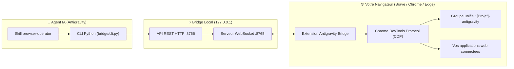

<div align="center">

# 🌐 Antigravity Browser Bridge

**Donnez à votre agent IA les mains libres sur votre vrai navigateur web.**

Pilotez directement votre session active (**Brave**, **Google Chrome**, **Edge**) sans bloquage d'API, sans profil isolé et en conservant tous vos identifiants connectés.

[](https://python.org)
[](https://developer.chrome.com/docs/extensions/mv3/intro/)
[](https://brave.com)
[](https://github.com/hugu641/antigravity-browser-bridge)
[](LICENSE)

</div>

---

## ⚡ Installation Rapide avec NPX (Sans rien cloner)

Vous pouvez installer et configurer tout le projet en **une seule commande** :

```bash
npx github:hugu641/antigravity-browser-bridge
```

> **Ce que fait cette commande automatiquement :**
> 1. 📦 Installe les dépendances Python nécessaires (`websockets`, `Pillow`).
> 2. 🤖 Déploie le skill `browser-operator` dans votre configuration Antigravity.
> 3. 📋 Copie directement le chemin de l'extension dans votre presse-papier.

---

## 🚀 Activation de l'Extension

Vous avez **deux méthodes** pour l'activer :

### Option A : Activation 100% Automatique (Zéro Clic)
Lancez votre navigateur avec l'extension pré-injectée en une commande :

```bash
npx github:hugu641/antigravity-browser-bridge launch
```
*(Fonctionne avec **Brave**, **Google Chrome** et **Microsoft Edge** via le drapeau Chromium `--load-extension` : l'extension est chargée et active immédiatement, sans jamais avoir besoin d'ouvrir la page des extensions !)*

---

### Option B : Activation dans votre navigateur déjà ouvert
Si votre navigateur est déjà ouvert avec vos sessions :
1. Rendez-vous sur :
   * **Brave :** `brave://extensions/`
   * **Chrome :** `chrome://extensions/`
   * **Edge :** `edge://extensions/`
2. Activez l'interrupteur **[Mode développeur]** (en haut à droite).
3. Cliquez sur **[Charger l'extension non empaquetée]** (en haut à gauche).
4. Le chemin a été copié automatiquement : faites simplement **`Ctrl + V`** dans la fenêtre de sélection !

---

## 💡 Pourquoi ce projet ?

Les outils d'automatisation traditionnels (Playwright headless, Puppeteer isolé) présentent des contraintes majeures :
- **Perte de vos sessions :** reconnexions obligatoires, blocages par CAPTCHA / 2FA.
- **Absence d'API :** des interfaces comme le *Roblox Creator Hub*, *ChatGPT Web*, ou des plateformes internes ne disposent pas d'API simple ou gratuite.
- **Pollution d'onglets :** fenêtres dispersées sans organisation.

**Antigravity Browser Bridge** résout ces problèmes :
1. **Utilise votre profil réel :** vos comptes déjà connectés (Roblox, YouTube Studio, ChatGPT, etc.) sont immédiatement pilotables.
2. **Rangement unifié par projet :** tous les onglets ouverts pour un même projet sont regroupés automatiquement sous `[NomDuProjet]-antigravity`.
3. **Contrôle matériel CDP (`chrome.debugger`) :** simulation matérielle des clics souris et des touches du clavier pour une interaction naturelle.
4. **Auto-guérison d'écran blanc :** détection des pages blanches (`is_blank`) ou figées avec rechargement automatique.
5. **Cycle de vie silencieux (Zéro CMD) :** l'IA démarre le serveur bridge discrètement en arrière-plan, effectue la tâche et coupe le serveur dès qu'elle a terminé.

---

## 🏗️ Architecture



---

## 🎮 Exemples d'Utilisation avec Antigravity

Demandez simplement ce que vous souhaitez réaliser dans le chat :

> *"Ouvre YouTube Studio et le Creator Hub de Roblox, et bascule les statistiques sur mon compte personnel."*  
> *"Va sur le Creator Hub de Roblox, crée un Gamepass VIP à 50 Robux et donne-moi son ID."*  
> *"Ouvre une nouvelle conversation sur ChatGPT et génère-moi un concept de map Roblox."*  

L'agent pilote le navigateur, rassemble les onglets dans votre groupe de travail, valide visuellement et coupe le serveur bridge une fois le travail terminé.

---

## 🛠️ Commandes Utiles (NPX & CLI)

```bash
# Installation et configuration automatique
npx github:hugu641/antigravity-browser-bridge

# Lancer le navigateur avec l'extension auto-chargée
npx github:hugu641/antigravity-browser-bridge launch

# Vérifier le statut de la connexion
npx github:hugu641/antigravity-browser-bridge status

# Démarrer manuellement le serveur bridge (si besoin)
npx github:hugu641/antigravity-browser-bridge start

# Éteindre le serveur bridge
npx github:hugu641/antigravity-browser-bridge stop
```

---

## 📦 Installation via le Skills CLI officiel

Vous pouvez également installer le skill dans n'importe quel projet via le gestionnaire officiel de skills :

```bash
npx skills add hugu641/antigravity-browser-bridge
```

---

## 📄 Licence

Projet distribué sous licence **MIT**.
