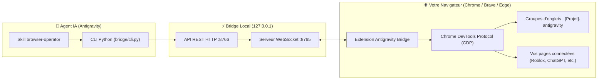

<div align="center">

# 🌐 Antigravity Browser Bridge

**Donnez à votre agent IA les mains libres sur votre vrai navigateur web.**

Pilotez directement votre session active (**Google Chrome**, **Brave**, **Edge**) sans bloquage d'API, sans session isolée et sans perte de vos identifiants connectés.

[](https://python.org)
[](https://developer.chrome.com/docs/extensions/mv3/intro/)
[](https://brave.com)
[](https://github.com)
[](LICENSE)

</div>

---

## 💡 Pourquoi ce projet ?

Les outils d'automatisation classiques (Playwright en mode headless, Puppeteer isolé) se heurtent souvent à des limites :
- **Perte de vos sessions :** vous devez vous reconnecter à chaque fois (2FA, CAPTCHAs, mots de passe).
- **Blocages d'API :** beaucoup de fonctionnalités web (ex: Roblox Creator Hub, ChatGPT Web, formulaires internes) n'ont pas d'API publique gratuite ou simple.
- **Désordre :** ouverture de dizaines de fenêtres dispersées.

**Antigravity Browser Bridge** résout tout cela :
1. **Utilise votre profil habituel :** vos comptes déjà connectés (Roblox, ChatGPT, YouTube, etc.) sont utilisables immédiatement.
2. **Rangement unifié par projet :** rassemble tous les onglets ouverts pour un même projet (YouTube, Roblox, ChatGPT, doc, etc.) dans un seul et même groupe nommé `[NomDuProjet]-antigravity` (déduit du workspace ou du contexte).
3. **Contrôle matériel CDP (`chrome.debugger`) :** simulation de vrais événements souris et clavier natifs, sans être détecté comme un bot basique.
4. **Auto-guérison d'écran blanc :** détecte si une page web s'affiche en blanc ou gèle, et la recharge automatiquement.

---

## 🏗️ Architecture



---

## ⚡ Installation Express

### Option 1 : En 1 commande avec NPX (Recommandé)

Lancez directement l'installeur interactif sans rien cloner :

```bash
# Directement depuis GitHub :
npx github:ton-pseudo/antigravity-browser-bridge

# Ou via le gestionnaire officiel de skills :
npx skills add ton-pseudo/antigravity-browser-bridge
```

> **Ce que fait l'installeur NPX :**
> 1. Installe les dépendances Python nécessaires.
> 2. Enregistre le skill `browser-operator` dans votre configuration Antigravity.
> 3. **Copie directement le chemin de l'extension dans votre presse-papier.**
> 4. Il ne vous reste plus qu'à faire `Ctrl+V` dans `chrome://extensions` ou `brave://extensions` en Mode Développeur !

---

### Option 2 : Via le script Windows (`install.bat`)

Si vous avez cloné ou téléchargé le projet :
1. Double-cliquez sur **`install.bat`**.
2. Allez sur `chrome://extensions/` ou `brave://extensions/`.
3. Activez le **Mode développeur** et cliquez sur **Charger l'extension non empaquetée** (faites `Ctrl+V` pour coller le chemin).

---

### Option 3 : Installation Manuelle

1. Installez les dépendances :
   ```bash
   pip install -r requirements.txt
   ```
2. Installez le skill pour Antigravity :
   ```bash
   # Crée le dossier global et copie le skill
   mkdir "%USERPROFILE%\.gemini\config\skills\browser-operator"
   copy ".agent\skills\browser-operator\SKILL.md" "%USERPROFILE%\.gemini\config\skills\browser-operator\SKILL.md"
   ```
3. Chargez le dossier `extension/` dans `chrome://extensions/` en Mode Développeur.

---

## 🚀 Démarrage

Double-cliquez sur **`start.bat`** (ou lancez `python bridge/server.py`).

Le serveur se lance :
* **WebSocket :** `ws://127.0.0.1:8765` *(reçoit la connexion de l'extension)*
* **API REST :** `http://127.0.0.1:8766` *(reçoit les requêtes de l'agent)*

Dès que votre navigateur est ouvert, l'extension affiche le badge vert **Connecté**.

---

## 🎮 Utilisation

### 1. Mode 100% Autonome avec l'Agent IA (Zéro CMD, Zéro tracas)

Vous n'avez même plus besoin de lancer `start.bat` manuellement !
Quand vous demandez une action web dans le chat, l'agent IA :
1. Démarre silencieusement le serveur bridge en tâche de fond (sans ouvrir de fenêtre d'invite de commandes CMD sur votre bureau).
2. Se connecte à votre navigateur et exécute les actions (clics, formulaires, extraction de données).
3. **Coupe et éteint automatiquement le serveur bridge** une fois la tâche terminée.

Exemples de demandes en langage naturel :
> *"Ouvre mon profil Roblox et dis-moi combien j'ai d'amis."*  
> *"Va sur le Creator Hub de Roblox dans le projet Ropro, crée un Gamepass VIP à 50 Robux et donne-moi l'ID."*  
> *"Va sur ChatGPT, ouvre une nouvelle conversation et demande-lui une idée de concept pour mon jeu."*  

---

### 2. Ou utilisez le CLI direct (`bridge/cli.py`)

Vous pouvez aussi piloter votre navigateur directement depuis votre terminal :

```bash
# Démarrer ou arrêter le serveur silencieusement
python bridge/cli.py start-server
python bridge/cli.py stop-server

# Vérifier la connexion
python bridge/cli.py status

# Ouvrir une URL dans un groupe de projet
python bridge/cli.py navigate "https://create.roblox.com" --project "Ropro" --new-tab

# Inspecter l'état de la page (éléments interactifs, coordonnées, détection d'écran blanc)
python bridge/cli.py page-info

# Prendre une capture d'écran
python bridge/cli.py screenshot --output "capture.png"

# Cliquer sur un bouton (par texte, sélecteur CSS ou coordonnées)
python bridge/cli.py click --text "Create a Pass"
python bridge/cli.py click --selector "button.submit"
python bridge/cli.py click --x 450 --y 230

# Taper du texte dans un champ et valider avec Entrée
python bridge/cli.py type "Pass VIP" --selector "input[name='name']" --press-enter

# Appuyer sur une touche du clavier (Enter, Escape, Tab, Backspace)
python bridge/cli.py press Enter

# Faire défiler la page (en pixels)
python bridge/cli.py scroll --delta-y 600

# Recharger la page (très utile en cas d'écran blanc)
python bridge/cli.py reload

# Évaluer du code JavaScript dans la page
python bridge/cli.py eval "document.title"
```

---

## 🛠️ Référence des Commandes CLI

| Commande | Options | Description |
| :--- | :--- | :--- |
| `start-server` | - | Démarre le serveur bridge silencieusement (sans fenêtre CMD). |
| `stop-server` | - | Éteint proprement le serveur local bridge. |
| `status` | - | Vérifie la liaison entre le serveur bridge et l'extension. |
| `navigate` | `<url> [--project <nom>] [--new-tab] [--timeout <s>]` | Navigue ou ouvre un onglet et l'ajoute au groupe `[nom]-antigravity`. |
| `page-info` | - | Renvoie l'URL, le titre, le texte visible et la liste des boutons/inputs cliquables. |
| `screenshot`| `[--output <fichier.png>]` | Prend une capture visuelle fidèle de l'onglet actif. |
| `click` | `[--text <txt>] [--selector <sel>] [--x <x> --y <y>]` | Simule un clic de souris matériel. |
| `type` | `<texte> [--selector <sel>] [--press-enter] [--clear]` | Saisit du texte avec support complet des caractères accentués. |
| `press` | `<touche>` | Envoie une touche unitaire (`Enter`, `Escape`, `Tab`, `Backspace`...). |
| `scroll` | `[--delta-y <px>] [--delta-x <px>]` | Fait défiler la page avec fluidité. |
| `reload` | - | Recharge l'onglet courant (contournement écran blanc). |
| `wait` | `[--text <txt>] [--selector <sel>] [--timeout <s>]` | Attend activement qu'un élément ou texte apparaisse. |
| `eval` | `<script>` | Exécute du JavaScript dans la page et retourne le résultat. |
| `list-tabs`| - | Liste tous les onglets ouverts et leurs groupes respectifs. |

---

## 🛡️ Résilience et Bonnes Pratiques

- **Keep-Alive Manifest V3 :** Le service worker de l'extension inclut des alarmes périodiques et des pings de battement de cœur pour éviter que Chrome ne le suspende après 30 secondes d'inactivité.
- **Écran Blanc (Blank Page Detection) :** La fonction `page-info` intègre `is_blank`. Si le site charge mal ou freeze, l'agent le détecte et effectue un `reload` automatique.
- **Sécurité locale :** Le serveur bridge écoute uniquement sur l'adresse de bouclage locale `127.0.0.1`. Aucun port n'est exposé sur votre réseau local.

---

## 📄 Licence

Ce projet est sous licence **MIT**. Vous êtes libre de l'utiliser, le modifier et l'adapter à vos propres besoins d'automatisation.
